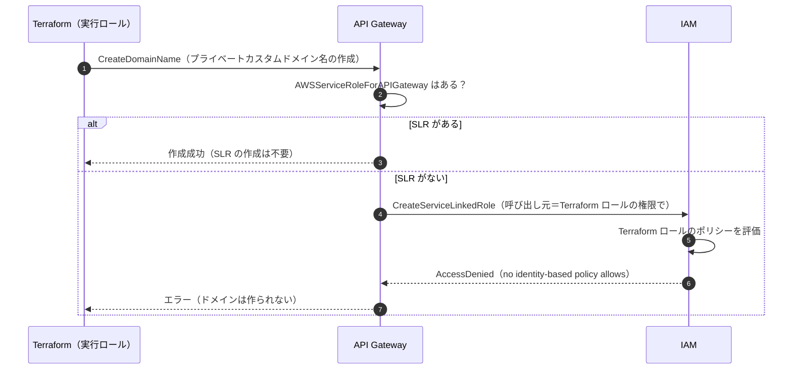
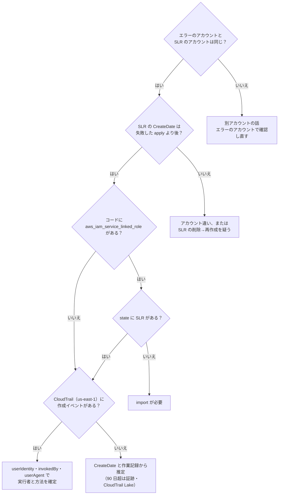
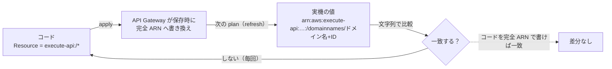

# API Gateway サービスリンクロール作成エラーと、ドメインポリシー「毎回ドリフト」の関連性評価

> Terraform（AWS Provider）× Amazon API Gateway プライベートカスタムドメイン名（ap-northeast-1）  
> 作成日：2026-10-16 ／ 同じ内容の Excel 版：`APIGW_SLR_Policy_Drift_Report.xlsx`

## 目次
0. 基本情報
1. 結論（ひとことで）
2. 質問への答え（結論サマリー）
3. 小学生にもわかる！やさしい解説
4. 歴史と背景
5. SLR が作られるしくみ
6. SLR はだれが・どうやって作ったのか
7. SLR の作成経路を確定させる確認フロー
8. ドリフトの解析
9. 関連性評価
10. 対処方針
11. コード例
12. 確認コマンド
13. 用語集
14. 参考資料

## 0. 基本情報

| 項目 | 内容 |
|---|---|
| 作成日 | 2026-10-16 |
| 情報の基準日 | 2026年10月時点で公開されている AWS 公式ドキュメント、Terraform AWS Provider のリリースノートとソースコード（main ブランチ）を確認して作成しました。 |
| 調査対象 | ① iam:CreateServiceLinkedRole の権限エラー（AWSServiceRoleForAPIGateway）<br>② aws_api_gateway_domain_name の policy が plan／apply のたびに変更対象になる事象（ドリフト）<br>③ ①と②の関連性 |
| 入力情報 | ご提示のエラーメッセージと、plan に表示された「変更前／変更後」の内容（アカウント ID・ドメイン名・VPC エンドポイント ID はマスク済み） |
| 前提・制約 | 実環境の Terraform コード・state・CloudTrail ログは未確認です。「だれが SLR を作ったか」は仮説と確認手順で示しています。確定は CloudTrail の記録で行ってください。 |
| 表記のルール | \<ACCOUNT_ID> のように \<> で囲んだ部分は、ご自身の値に置き換えます（\<> も消します）。SLR＝サービスリンクロール。 |

## 1. 結論（ひとことで）

- **① SLR が存在する理由**：SLR は「API・カスタムドメイン名・VPC リンクを作った人（呼び出し元）の権限」で自動作成されます。Terraform ロールにはその権限が無かったので失敗しました。それでも SLR があるのは、作成権限を持つ別の誰か（または別の仕組み）が同じアカウントで一度作ったためと考えられます。だれが・いつ作ったかは CloudTrail（us-east-1）で確定できます。
- **② ドリフトの原因**：API Gateway はドメインのリソースポリシーを保存するとき、省略形の execute-api:/\* を完全な ARN（…:/domainnames/\<ドメイン名>+\<ドメイン名ID>）に書き換えます。Terraform は文字どおりに比べるため「違う」と判定し、apply で戻す → AWS がまた書き換える、を毎回くり返します。
- **③ 2つの関係**：直接の因果関係はありません（SLR を直してもドリフトは消えません）。ただし、どちらも同じ「プライベートカスタムドメイン名」の作成で表に出たもので、「AWS が裏で自動的に行うこと」が Terraform のコードに書かれていない、という共通の構造を持ちます。対処は別々に行います。

## 2. 質問への答え（結論サマリー）

### Q1. SLR（AWSServiceRoleForAPIGateway）は、いつ・どうやって作られたのか？

- **答え**：作成権限（iam:CreateServiceLinkedRole）を持つ誰か／何かが、同じ AWS アカウントで「API・カスタムドメイン名・VPC リンクのどれかを作成した瞬間」に自動で作られたか、「CLI などで SLR を直接作成した瞬間」に作られた、と考えるのが自然です。SLR はアカウントに 1 つ（全リージョン共通）なので、どのリージョンでの操作でも作られます。正確な日時は IAM の CreateDate、実行者は CloudTrail（us-east-1）の CreateServiceLinkedRole イベントで確定できます。
- **根拠**：API Gateway 開発者ガイド「API・カスタムドメイン名・VPC リンクの作成時に SLR を作成する」。IAM ユーザーガイド「SLR を作成する IAM エンティティには権限の設定が必要」。
- **確度**：◎ 仕組み ／ △ 実行者は要確認

### Q2. 「AWS が自動で作る」のに、なぜ権限エラーになったのか？

- **答え**：自動作成は「AWS 自身の権限」ではなく「操作をお願いした人（呼び出し元）の権限」で行われるためです。エラー文の主語（User: …）が Terraform のロールになっているのがその証拠です。Terraform ロールに Allow が無かったため「暗黙の拒否（because no identity-based policy allows …）」になりました。Deny で拒否されたわけではないので、Allow を追加すれば通るタイプのエラーです。
- **根拠**：IAM ユーザーガイド「アクセス拒否エラーメッセージのトラブルシューティング」「Forward access sessions（呼び出し元の権限で下流のサービスを呼ぶ仕組み）」。
- **確度**：◎

### Q3. SLR は手動で作成できるのか？

- **答え**：できます。① CLI：aws iam create-service-linked-role --aws-service-name ops.apigateway.amazonaws.com　② API：CreateServiceLinkedRole　③ 間接的に：コンソールなどで API／カスタムドメイン名／VPC リンクを作る（そのとき自動作成される）。どの方法でも、実行する人に iam:CreateServiceLinkedRole の権限が必要です。
- **根拠**：IAM ユーザーガイド「Create a service-linked role」（コンソール／CLI／API での作成手順）。
- **確度**：◎

### Q4. Terraform で SLR を明示的に作る定義を入れていたのか？

- **答え**：コードに resource "aws_iam_service_linked_role"（aws_service_name = "ops.apigateway.amazonaws.com"）があるかで判別できます。エラーの書き出しが「operation error IAM: CreateServiceLinkedRole」なら明示定義、「operation error API Gateway: CreateDomainName（CreateRestApi／CreateVpcLink など）」なら API Gateway による暗黙の自動作成です。どちらの経路でも、Terraform ロールに権限が無ければ失敗する点は同じです。
- **根拠**：Terraform AWS Provider のリソース仕様（aws_iam_service_linked_role）と、エラー表示の形式（operation error \<サービス>: \<操作>）。
- **確度**：◎ 判別方法

### Q5. なぜ毎回ドリフトする（plan／apply のたびに変更対象になる）のか？

- **答え**：API Gateway が、ドメインのリソースポリシー内の省略形 execute-api:/\* を、保存時に完全な ARN（arn:aws:execute-api:ap-northeast-1:\<ACCOUNT_ID>:/domainnames/\<ドメイン名>+\<ドメイン名ID>）へ書き換えるためです。Terraform はポリシーの Resource を文字列で厳密に比べるので、毎回「違う」と判定し、apply で省略形に戻し、AWS がまた書き換えます。条件キーの大文字小文字（aws:SourceVpce と aws:sourcevpce など）が実機と違う場合も、同じ理由で差分になります。
- **根拠**：Provider のソース（domain_name.go：特別な変換処理なし）、比較ライブラリ awspolicyequivalence（Resource・条件キーは厳密一致）、同じ仕組みの既知事例 GitHub Issue #15602（REST API、2020年〜）。
- **確度**：◎

### Q6. SLR の事象とドリフトは関係があるのか？

- **答え**：直接の因果関係はありません（独立した 2 つの事象）。SLR の権限はポリシーの保存・書き換えに関わらず、SLR を作ってもドリフトは消えません。一方で ① どちらもプライベートカスタムドメイン名の作成で表に出た、② ドリフトが見えている＝ドメインの作成に成功している＝SLR が既に存在する、という時間的なつながり、③「AWS が裏で自動的に行うこと」がコードに無い、という共通の構造、の 3 点で間接的には関連しています。
- **根拠**：「08_関連性評価」の観点別の評価を参照。
- **確度**：◎

### Q7. どう対処すればよいか？

- **答え**：SLR：Terraform ロールに API Gateway の SLR だけに限定した iam:CreateServiceLinkedRole を付与する（新しいアカウントでの再発防止）か、アカウントの基盤（ベースライン）側で SLR を事前作成・管理します。ドリフト：ポリシーを AWS が保存する形（完全 ARN・同じ条件キー表記）で書きます。すぐ止めたい場合の暫定策は lifecycle の ignore_changes = [policy] です（長期利用は非推奨）。
- **根拠**：「09_対処方針」「10_コード例」を参照。
- **確度**：◎

### 総合判定

| No | 観点 | 説明 | ポイント | 判定 |
|---|---|---|---|---|
| 1 | 直接の因果関係 | 別々の仕組み（IAM の権限評価／API Gateway のポリシー正規化）で起きており、一方が他方を引き起こしていない。 | SLR を作っても、権限を付けてもドリフトは消えない。 | なし |
| 2 | 間接的な関連 | 同じ新機能（プライベートカスタムドメイン名）の作成で表に出た。ドリフトが見えている＝SLR が既にある、という時間の前後関係もある。 | 根本は「AWS が裏で自動的に行うことがコードに無い」という同じ型。 | あり |
| 3 | 対応の要否 | 片方を直しても、もう片方は解決しない。 | 別々に対処する（09_対処方針）。 | 両方必要 |
| 4 | 急ぎ度 | SLR：新しいアカウントや SLR の削除後に再発する。ドリフト：アクセス制御の意味は同じでセキュリティ上の実害はないが、変更の見落とし・CI のノイズになる。 | どちらも「一度通ったから終わり」ではない。 | 中 |

## 3. 小学生にもわかる！やさしい解説

AWS のしくみを「学校」にたとえて説明します。

### 登場人物（たとえ）

| ほんとうの名前 | たとえると | ひとこと説明 |
|---|---|---|
| AWS アカウント | 大きな学校 | みんなが使う設備（サーバーや受付窓口）がある場所。 |
| IAM（アイアム） | 職員室の「許可係」 | 「だれが何をしてよいか」を決めて、許可証（ポリシー）を管理する。 |
| IAM ロール | 許可の腕章（わんしょう） | 腕章をつけると、腕章に書いてあることだけができる。 |
| Terraform（テラフォーム） | 設計図どおりに作る工作ロボット | 設計図（コード）を読んで設備を作る。作った後も、設計図と実物を見くらべる。 |
| API Gateway | 学校の受付係 | 外からのお願いを受け付けて、正しい教室（プログラム）へ案内する。 |
| プライベートカスタムドメイン名 | 校内専用の受付窓口の「わかりやすい名前」 | 2024年11月から使えるようになった新しい窓口。校内専用の通路（VPC エンドポイント）からだけ入れる。 |
| サービスリンクロール（SLR） | 受付係“専用”の腕章 | 受付係が、証明書の倉庫やネットワークの配線などを使うための腕章。中身は AWS が決めていて書きかえられない。学校に 1 つあれば、全員の作業で使い回せる。 |
| iam:CreateServiceLinkedRole | 「専用腕章を作ってよい」という許可 | これを持っている人がお願いしたときだけ、専用腕章が作られる。 |
| リソースポリシー | 窓口にはる「だれが入っていいか」の張り紙 | 今回は「この通路（VPC エンドポイント）から来た人だけ入れる」と書いてある。 |
| execute-api:/\* | 張り紙に書く「この窓口ぜんぶ」というあだ名 | 短く書ける便利な書き方。 |
| 完全な ARN | 正式な住所 | 「〇〇県△△市…番地…号室」のように、どこのことか 1 つに決まる書き方。 |
| CloudTrail（クラウドトレイル） | 防犯カメラ | だれが・いつ・何をしたかを記録している。 |

### お話① 専用の腕章（SLR）は、だれが作ったの？

① **お願い**：工作ロボット（Terraform）が、受付係（API Gateway）に「校内専用の新しい窓口を作って！」とお願いしました。  
② **腕章が必要**：受付係は「仕事をするには専用腕章がいるね。でも、まだ学校に 1 つもない。作らなきゃ」と考えました。  
③ **ルール**：専用腕章は、受付係が勝手には作れません。「お願いした人」の許可証を使って作る、というルールです。  
④ **断られた**：工作ロボットの許可証には「専用腕章を作ってよい」と書いてありませんでした。許可係（IAM）は「書いてないことはできません」と断りました。これが今回のエラーです。このとき窓口も作られませんでした。  
⑤ **だれかが作った**：そのあと、「専用腕章を作ってよい」許可を持っているだれか（たとえば先生＝管理者）が、受付係に窓口づくりをお願いしたか、腕章を直接作りました。そのときに専用腕章ができました。  
⑥ **使い回し**：専用腕章は学校に 1 つあれば、だれの作業でも使い回せます。だから次に工作ロボットがお願いしたときは、もう作る必要がなく、成功しました。  
⑦ **だれが作った？**：「だれが・いつ作ったか」は、防犯カメラ（CloudTrail）の記録を見るとわかります。腕章（IAM）の記録は「us-east-1」という場所の記録を見ます。  
⑧ **これから**：新しい学校（新しい AWS アカウント）では、また同じことが起きます。工作ロボットに「専用腕章だけは作ってよい」許可を少しだけあげるか、先に先生が腕章を作っておくと安心です。  

### お話② 張り紙が毎回「ちがう」と言われるのはなぜ？

① **設計図**：設計図（Terraform のコード）には、窓口の張り紙に「この窓口ぜんぶ（execute-api:/\*）」とあだ名で書いてあります。  
② **事務室が書き直す**：ところが学校の事務室（API Gateway）は、張り紙をはるときに、あだ名を「正式な住所（arn:aws:execute-api:…:/domainnames/ドメイン名+ドメイン名ID）」に書き直してはります。  
③ **見くらべ**：工作ロボットは毎回、設計図と実物を 1 文字ずつ見くらべます（terraform plan）。「設計図はあだ名、実物は正式な住所…ちがう！」  
④ **直す→また書き直される**：ロボットがあだ名に直す（apply）→ 事務室がまた正式な住所に書き直す → 次の見くらべでまた「ちがう！」。これが「毎回のドリフト」です。  
⑤ **中身は同じ**：あだ名も正式な住所も、指している窓口は同じです。だから「だれが入れるか」は変わっておらず、困ることは起きていません。  
⑥ **でも困ること**：毎回「変更あり」と出るので、本当に大事な変更（だれかが張り紙をこっそり書きかえた、など）を見のがしやすくなります。  
⑦ **直し方**：設計図に、はじめから「正式な住所」で書いておけば、見くらべても同じなので、もう「ちがう」と言われません。  

### お話③ 2つのお話は関係あるの？

① **別のお話**：腕章のお話（SLR）と、張り紙の書き直しのお話（ドリフト）は、別々の係で起きた別の出来事です。腕章を作っても張り紙の書き直しは止まりませんし、その逆もありません。  
② **同じ窓口で起きた**：どちらも「校内専用の新しい窓口」を作ったときに見つかりました。窓口が作れた（＝腕章がもうある）からこそ、張り紙のお話が見えるようになった、という順番のつながりはあります。  
③ **似ているところ**：どちらも、AWS が親切で「裏でこっそりやってくれること」（腕章を自動で作る・あだ名を正式な住所に直す）が、設計図に書かれていないために起きました。  
④ **直し方**：だから 2 つは「別々に」直します。腕章は「作る許可をあげる」か「先に作っておく」。張り紙は「正式な住所で書く」。  

### まとめ（3 行で）

1. **腕章**：専用腕章（SLR）は「お願いした人の許可証」で作られる。工作ロボットには作る許可が無かった。許可のあるだれかが作ったので、今は使い回せている。
2. **張り紙**：張り紙の「あだ名」を事務室が「正式な住所」に書き直すので、ロボットが毎回「ちがう」と言う。設計図を正式な住所で書けば止まる。
3. **関係**：2 つは別々のお話。でも同じ新しい窓口で起きていて、どちらも「AWS が裏でやってくれること」が設計図に無いのが原因。

## 4. 歴史と背景（なぜ必要になったのか）

サービスリンクロールとプライベートカスタムドメイン名が生まれた理由と、今回の現象につながる年表です。

### 背景① サービスリンクロール（SLR）が生まれた理由

| No | 見出し | 説明 | 今回との関係 |
|---|---|---|---|
| 1 | 昔は「サービスロール」を手作り | AWS のサービスが利用者の代わりに他のサービスを操作するには、利用者が IAM ロール（サービスロール）を自分で作り、信頼ポリシーと権限を正しく設定してサービスに渡す必要がありました。 | API Gateway の CloudWatch Logs 用ロール（apigateway.amazonaws.com を信頼）は、今もこの方式です。 |
| 2 | 手作りの問題点 | 権限の付けすぎ・足りなさ、うっかり編集や削除でサービスが止まる、どのロールが何のためのものか分からない、といった事故が起きやすい状態でした。 | — |
| 3 | 2017年4月 SLR の登場 | 「権限は AWS が定義する」「そのサービスだけが引き受けられる」「必要な権限を消す変更はできない」「操作は CloudTrail に記録される」という特別なロールが登場しました（最初の対応サービスは Amazon Lex）。 | AWSServiceRoleForAPIGateway もこの仕組みの 1 つです。 |
| 4 | 作成は「必要になったとき」 | 多くのサービスは、そのサービスで特定の操作（リソースの作成など）をしたときに SLR を自動作成します。ただし作成は操作した人の権限で行われるため、その人に iam:CreateServiceLinkedRole が必要です。 | 今回のエラーの直接の理由です。 |
| 5 | 2017年9月 削除にも対応 | IAM から SLR を削除できるようになりました。ただし、そのロールを使っているリソースが残っている間は削除できません（安全装置）。 | API・カスタムドメイン名・VPC リンクが残っていると削除できません。 |

### 背景② API Gateway に SLR が必要な理由

| No | 見出し | 説明 | 今回との関係 |
|---|---|---|---|
| 1 | 利用者のアカウントの中で作業する | API Gateway は、カスタムドメイン名の証明書（ACM）の参照、VPC リンク用のネットワークインターフェースの作成、アクセスログの Firehose への送信、X-Ray のトレース、ログ配信の設定などを、利用者のアカウントの中で行います。 | だから「カスタムドメイン名の作成」が SLR 作成のきっかけになります。 |
| 2 | 2017年10月 専用の権限ポリシー | API Gateway 用 SLR の権限ポリシー APIGatewayServiceRolePolicy が 2017-10-20 に作成され、2021-07-12 に acm:GetCertificate が追加されました（現在 v9）。 | このポリシーに、execute-api のリソースポリシーを書き換える権限はありません。 |

### 背景③ プライベートカスタムドメイン名が生まれた理由

| No | 見出し | 説明 | 今回との関係 |
|---|---|---|---|
| 1 | 2018年6月 プライベート API | VPC エンドポイント経由でのみ呼べる「プライベート API」が登場し、社内専用の API を安全に作れるようになりました。 | — |
| 2 | 名前が使いにくい | ただしカスタムドメイン名は公開 API 専用でした。プライベート API は、API ID と VPC エンドポイント ID を含む長い既定の URL や、Host ヘッダー／x-apigw-api-id ヘッダーを付けて呼ぶ必要がありました。 | — |
| 3 | 2024年11月 プライベートカスタムドメイン名 | 社内向けの API にも分かりやすい名前（例：api.internal.example.com）を付けられるようになりました。アカウントをまたいだ共有（AWS RAM）にも対応しました。 | 今回のドメインはこの機能です。 |
| 4 | 新しく増えた管理対象 | 「ドメイン名 ID（+abcd1234 の部分）」「ドメイン専用のリソースポリシー」「ドメイン名アクセス関連付け（VPC エンドポイントとのひも付け）」が登場しました。プライベートのドメイン名はアカウントをまたいで重複してよいため、ID 付きの ARN で区別します。 | ドリフトの原因であるポリシーの書き換え先（完全 ARN）に、このドメイン名 ID が入ります。 |
| 5 | ポリシーは多重チェック | 呼び出すには「ドメインのリソースポリシー」「プライベート API のリソースポリシー」「VPC エンドポイントポリシー」のすべてで許可されている必要があります。 | ドメイン側のポリシーを Terraform で正しく管理し続ける価値は高い。 |

### 年表

| 年月 | 出来事 | なぜ大事？ | 今回との関係 | 出典 |
|---|---|---|---|---|
| 2015-07 | Amazon API Gateway の提供開始（7月9日） | API の「受付係」サービスの始まり。 | — | AWS What's New（2015/07） |
| 2017-04 | IAM サービスリンクロールの登場（4月19日。最初の対応は Amazon Lex） | サービス用ロールを安全・簡単にする仕組み。 | SLR の誕生。 | AWS What's New（2017/04）、AWS Security Blog |
| 2017-09 | IAM から SLR を削除できるように（使用中は削除不可） | 後片付けと安全性の両立。 | 削除には関連リソースの削除が先。 | AWS What's New（2017/09） |
| 2017-10 | APIGatewayServiceRolePolicy の作成（10月20日） | API Gateway 用 SLR の権限の土台。 | 今回の SLR の中身。 | AWS Managed Policy Reference |
| 2017-11 | リージョン別エンドポイント、VPC 内のバックエンドとのプライベート統合（VPC リンク）が登場 | API Gateway が利用者のアカウント内の資源を扱う場面が増えた。 | SLR を使う代表的な機能。 | AWS Compute Blog（Private Endpoints 紹介記事内の経緯） |
| 2018-06 | プライベート API の登場（6月14日） | 社内専用 API の基盤。 | 今回の API の土台。 | AWS What's New（2018/06） |
| 2020-10 | Terraform で REST API のポリシーが毎回差分になる問題が報告される（Issue #15602） | execute-api:/\* が完全 ARN に書き換えられることが原因だと、以前から知られていた。 | 今回と同じ仕組み。 | GitHub Issue #15602 |
| 2021-07 | APIGatewayServiceRolePolicy に acm:GetCertificate を追加。変更履歴の公開を開始（7月12日） | 証明書を扱う権限の強化。 | カスタムドメイン名と SLR の関係。 | API Gateway 開発者ガイド |
| 2021-11 | CloudTrail が IAM などグローバルサービスのイベントを us-east-1 に記録する方式に統一（11月22日） | IAM の操作記録の探し方が決まった。 | SLR の作成者を調べるときは us-east-1 を見る。 | CloudTrail ユーザーガイド |
| 2024-11 | プライベート REST API のカスタムドメイン名に対応（11月21日） | ドメイン名 ID・ドメイン専用ポリシー・アクセス関連付け・RAM 共有が登場。 | 今回のドメインとポリシー。 | AWS What's New（2024/11）、AWS Compute Blog |
| 2024-12 | Terraform AWS Provider v5.81.0（12月12日）：aws_api_gateway_domain_name に policy・domain_name_id・PRIVATE を追加 | Terraform でプライベートカスタムドメイン名を作れるようになった。 | 今回の policy 属性。 | GitHub Release v5.81.0 |
| 2024-12 | v5.82.0（12月19日）：aws_api_gateway_domain_name_access_association を追加、プライベートドメインの arn を修正 | VPC エンドポイントとの関連付けも Terraform で管理できるようになった。 | — | GitHub Release v5.82.0 |
| 2025-01 | v5.83.0：プライベートドメインの更新時の不具合（Issue #40699）を修正 | v5.81〜v5.82.x では、policy を更新する apply 自体が失敗することがあった。 | ドリフトを直す apply に影響。 | GitHub Issue #40699 |
| 2025-06 | API Gateway のルーティングルールが登場（公開・プライベート両方の REST API） | カスタムドメイン名の機能拡張（routing_mode）。 | ドメインの設定項目が増えた。 | AWS What's New（2025/06） |
| 2025-06 | Terraform AWS Provider v6.0.0（6月18日）：リソースごとの region 引数など。aws_region データソースの name は非推奨（region を使う） | メジャーバージョンアップ。 | コード例のバージョン差に注意。 | GitHub Release v6.0.0、Upgrade Guide |
| 2026-10 | 本書の作成時点：Provider の aws_api_gateway_domain_name は「IAM ポリシーとして同等なら差分にしない」比較を行うが、execute-api:/\* と完全 ARN を同じとみなす処理は無い | 今もコード側で AWS の書き方に合わせる必要がある。 | ドリフトが続く理由。 | Provider ソース（domain_name.go）、awspolicyequivalence |

## 5. サービスリンクロール（SLR）が作られるしくみ

Terraform がプライベートカスタムドメイン名を作るとき、裏側で何が起きているか。



### ① 処理の流れ

| Step | だれが | 何をする | 結果・ポイント |
|---|---|---|---|
| 1 | Terraform（実行ロール） | API Gateway に CreateDomainName（カスタムドメイン名の作成）をリクエストする。 | API の作成（CreateRestApi）や VPC リンクの作成（CreateVpcLink）でも同じ。 |
| 2 | API Gateway | このアカウントに AWSServiceRoleForAPIGateway があるか確認する。 | SLR はアカウントに 1 つ（全リージョン共通）。 |
| 3a | API Gateway | ある → そのまま作成処理を続ける。 | SLR の作成は不要なので、iam:CreateServiceLinkedRole の権限も不要。 |
| 3b | API Gateway → IAM | ない → 「呼び出し元（Terraform ロール）の権限で」 SLR の作成（CreateServiceLinkedRole）を依頼する。 | AWS 自身の権限ではない点がポイント（Forward access sessions と同じ考え方）。 |
| 4 | IAM | Terraform ロールのポリシーを評価する。 | iam:CreateServiceLinkedRole の Allow が無い → 暗黙の拒否。 |
| 5 | IAM → API Gateway → Terraform | 拒否エラーを返す。 | User: …terraform… is not authorized to perform: iam:CreateServiceLinkedRole … because no identity-based policy allows … |
| 6 | Terraform | apply が失敗する。 | ドメインは作られない（このため、この時点ではドリフトも起きようがない）。 |
| 7 | 権限を持つ別の誰か | API Gateway のリソースを作成する、または SLR を直接作成する。 | このとき SLR が作られる（作成日時＝IAM の CreateDate）。 |
| 8 | Terraform | 再実行する。 | Step 3a のルートになり成功する（以後、そのアカウントでは再発しない）。 |

### ② エラーメッセージの読み解き

| No | エラー文の部分 | 意味 | ポイント |
|---|---|---|---|
| 1 | `User: arn:aws:sts::<ACCOUNT_ID>:assumed-role/terraform/…` | 権限をチェックされたのは Terraform のロール。 | AWS の権限ではなく「呼び出し元」の権限が使われた証拠。 |
| 2 | `is not authorized to perform: iam:CreateServiceLinkedRole` | SLR を作る操作が許可されていない。 | — |
| 3 | `on resource: arn:aws:iam::<ACCOUNT_ID>:role/aws-service-role/ops.apigateway.amazonaws.com/AWSServiceRoleForAPIGateway` | 作ろうとしたのは API Gateway 用の SLR。 | パスの aws-service-role/ は SLR 専用。信頼するサービスは ops.apigateway.amazonaws.com。 |
| 4 | `because no identity-based policy allows the iam:CreateServiceLinkedRole action` | ID ベースのポリシーに Allow が無い＝暗黙の拒否。 | 明示的な Deny（SCP など）なら「with an explicit deny in a … policy」と表示される。今回は Allow を追加すれば解決するタイプ。 |
| 5 | `（Terraform 側の書き出し）operation error API Gateway: CreateDomainName …` | API Gateway 経由の暗黙の自動作成で失敗した。 | 「operation error IAM: CreateServiceLinkedRole」なら、Terraform コードの明示定義（aws_iam_service_linked_role）で失敗した。 |

### ③ SLR の基本情報

| No | 項目 | 内容 | 補足 |
|---|---|---|---|
| 1 | ロール名 | AWSServiceRoleForAPIGateway | 名前は固定（変更不可）。 |
| 2 | パス／ARN | /aws-service-role/ops.apigateway.amazonaws.com/<br>arn:aws:iam::\<ACCOUNT_ID>:role/aws-service-role/ops.apigateway.amazonaws.com/AWSServiceRoleForAPIGateway | — |
| 3 | 信頼するサービス | ops.apigateway.amazonaws.com | CloudWatch Logs 用の通常のサービスロールが信頼する apigateway.amazonaws.com とは別物。 |
| 4 | 権限ポリシー | APIGatewayServiceRolePolicy（AWS 管理ポリシー、v9） | 2017-10-20 作成、2021-07-12 最終更新。 |
| 5 | 個数・範囲 | 1 アカウントに 1 つ。全リージョン共通。 | IAM はグローバルサービス。 |
| 6 | 作成のきっかけ | API・カスタムドメイン名・VPC リンクの作成時（無ければ自動作成）。 | 削除しても、同じ操作で再作成される。 |
| 7 | 手動作成 | 可能（CLI：aws iam create-service-linked-role --aws-service-name ops.apigateway.amazonaws.com）。 | 実行者に iam:CreateServiceLinkedRole が必要。 |
| 8 | 編集 | 権限は編集できない。説明文のみ変更できる。 | — |
| 9 | 削除 | 関連リソース（API・カスタムドメイン名・VPC リンク）を消した後に可能。 | 使用中は削除できない（安全装置）。 |
| 10 | Terraform での扱い | 管理しなくても動く。管理する場合は aws_iam_service_linked_role。 | アカウント共有の資源なので、アプリ単位の state での管理は非推奨。 |
| 11 | 作成に必要な権限 | iam:CreateServiceLinkedRole（条件 iam:AWSServiceName = ops.apigateway.amazonaws.com で限定できる）。 | AWS 管理ポリシー PowerUserAccess にも含まれる。 |

### ④ 権限ポリシー（APIGatewayServiceRolePolicy）の中身

| No | 分類 | 主なアクション | 何のため | ドリフトとの関係 |
|---|---|---|---|---|
| 1 | Elastic Load Balancing | AddListenerCertificates／RemoveListenerCertificates／ModifyListener／DescribeListeners／DescribeLoadBalancers | ロードバランサーのリスナー（証明書）の操作・参照。 | 関係なし |
| 2 | AWS X-Ray | PutTraceSegments／PutTelemetryRecords／GetSamplingTargets／GetSamplingRules | トレース情報の送信。 | 関係なし |
| 3 | CloudWatch Logs（ログ配信） | CreateLogDelivery／GetLogDelivery／UpdateLogDelivery／DeleteLogDelivery／ListLogDeliveries | ログ配信の設定。 | 関係なし |
| 4 | Amazon Data Firehose | DescribeDeliveryStream／PutRecord／PutRecordBatch（amazon-apigateway-\* のストリームのみ） | アクセスログを Firehose へ送る。 | 関係なし |
| 5 | AWS Certificate Manager | DescribeCertificate／GetCertificate | カスタムドメイン名の証明書の参照。 | 関係なし（ドメイン作成で SLR が必要になる理由の 1 つ） |
| 6 | Amazon EC2（ネットワークインターフェース） | CreateNetworkInterface／DeleteNetworkInterface／ModifyNetworkInterfaceAttribute／Describe 系／CreateTags（Owner・VpcLinkId タグのみ）など | VPC リンク用のネットワークインターフェースの作成・管理。 | 関係なし |
| 7 | AWS Cloud Map | DiscoverInstances／GetNamespace／GetService | サービス検出（HTTP API のプライベート統合）。 | 関係なし |

※ どの権限も「execute-api のリソースポリシー（ドメインのポリシー）を保存・変換する」ものではありません。SLR とドリフトが無関係である根拠の 1 つです。

## 6. SLR はだれが・どうやって作ったのか（仮説と見分け方）

Terraform ロールに権限が無いのに SLR が存在する理由の候補。可能性は一般的な運用での起こりやすさの目安で、確定は CloudTrail で行います。

### 仮説 1：管理者などがコンソールで API・カスタムドメイン名・VPC リンクを作成した（テスト作成や手動構築を含む）（可能性：◎ 高）

- **起こり方**：管理者の権限（AdministratorAccess など）で、API Gateway が SLR を自動作成した。
- **CloudTrail での見分け方**：CreateServiceLinkedRole の成功イベントの userIdentity が管理者。invokedBy や sourceIPAddress に AWS サービス名（例：apigateway.amazonaws.com）。同じ時刻に、各リージョンの CloudTrail に CreateDomainName／CreateRestApi／CreateVpcLink などがある（その userAgent でコンソールか CLI かが分かる）。
- **補足**：SLR は全リージョン共通。別のリージョンでの操作でも作られる。

### 仮説 2：エラーを見た誰かが、CLI／API で SLR を直接作成した（可能性：◎ 高）

- **起こり方**：aws iam create-service-linked-role --aws-service-name ops.apigateway.amazonaws.com を実行した。
- **CloudTrail での見分け方**：invokedBy が無い。userAgent に aws-cli や CloudShell など。直前・直後に API Gateway の操作が無い。
- **補足**：「エラー対応で先に作っておいた」はよくある対応。

### 仮説 3：PowerUserAccess などを持つ開発者や、別の仕組み（SAM／CDK／Serverless Framework／別の Terraform）が API Gateway のリソースを作成した（可能性：○ 中）

- **起こり方**：その人（仕組み）の権限で自動作成された。PowerUserAccess は iam:CreateServiceLinkedRole を含む。
- **CloudTrail での見分け方**：userIdentity がそのロール。API Gateway 側イベントの userAgent に aws-sam-cli／aws-cdk／cloudformation.amazonaws.com／Terraform など。
- **補足**：共用のアカウントで起きやすい。

### 仮説 4：組織の基盤（StackSets、Control Tower のカスタマイズなど）で事前に作成された（可能性：△ 低〜中）

- **起こり方**：管理アカウント側の自動化で作られた。
- **CloudTrail での見分け方**：userIdentity が StackSet の実行ロールなど。同じ時刻にほかの SLR もまとめて作られていれば有力。
- **補足**：社内の基盤チームに確認する。

### 仮説 5：Terraform ロールの権限が一時的に広げられていた（後で戻された）（可能性：△ 低〜中）

- **起こり方**：Terraform 自身が作成した。
- **CloudTrail での見分け方**：userIdentity が Terraform ロールで成功している。前後に AttachRolePolicy／PutRolePolicy／CreatePolicyVersion などの IAM の変更がある。
- **補足**：IAM の変更履歴も CloudTrail で確認する。

### 仮説 6：Terraform コードに aws_iam_service_linked_role があり、別の（権限のある）provider 設定・ロールで作成された（可能性：△ 低）

- **起こり方**：Terraform（別ロール）が明示的に作成した。
- **CloudTrail での見分け方**：userAgent に Terraform。userIdentity が別のロール。
- **補足**：state に aws_iam_service_linked_role があるか確認する。

### 仮説 7：見ているアカウントが違う（エラーは別のアカウント）（可能性：△ 低）

- **起こり方**：確認する対象を取り違えた。
- **CloudTrail での見分け方**：エラー文の ARN に含まれるアカウント ID と、確認したアカウント ID を照合する。
- **補足**：開発・検証・本番でアカウントが分かれている場合。

### 仮説 8：AWS が、誰の権限も使わずに勝手に作った（可能性：× ほぼなし）

- **起こり方**：—
- **CloudTrail での見分け方**：—
- **補足**：API Gateway の SLR は「API・ドメイン・VPC リンクの作成時に作る」と明記されている。今回も Terraform の権限で拒否されている。

## 7. SLR の作成経路を確定させる確認フロー

上から順に確認します。コマンドは「11_確認コマンド」を参照してください。



| Step | 確認すること | 確認方法 | YES の場合 | NO の場合 |
|---|---|---|---|---|
| 1 | エラー文のアカウント ID と、SLR を見つけたアカウント ID は同じ？ | エラー文の ARN と aws sts get-caller-identity の Account を照合する。 | Step 2 へ。 | 別のアカウントの話。エラーが出たアカウントで SLR の有無を確認し直す。 |
| 2 | SLR の作成日時は、失敗した apply より後？ | aws iam get-role --role-name AWSServiceRoleForAPIGateway の CreateDate（UTC。日本時間は +9 時間）。 | Step 3 へ。 | 失敗時点ではまだ無かったはずなので、アカウント違いか、SLR の削除→再作成を疑う（Step 1 と、CloudTrail の DeleteServiceLinkedRole を確認）。 |
| 3 | Terraform コードに aws_iam_service_linked_role（ops.apigateway.amazonaws.com）がある？ | grep／Select-String でコードを検索する。 | Step 4 へ（明示定義のルート）。 | Step 5 へ（暗黙の自動作成のルート）。 |
| 4 | terraform state に、その SLR がある？ | terraform state list。 | Terraform の管理下（作成済み、または import 済み）。Step 5 で作成者を確認する（import なら作成者は別）。 | コードにあるのに state に無い → 次の apply で作成を試みて失敗する可能性がある。import が必要。 |
| 5 | CloudTrail（us-east-1）に CreateServiceLinkedRole の成功イベントがある？ | lookup-events（直近 90 日）。90 日より前は証跡（S3）や CloudTrail Lake で検索する。 | userIdentity・invokedBy・userAgent を「05_SLR作成経路」の表と照合して、実行者と方法を確定する。 | 記録が無い（期間外・証跡なし）→ CreateDate と社内の作業記録・チケットから推定する。 |
| 6 | 実行者は Terraform ロール？ | Step 5 のイベントの userIdentity.arn。 | その時点では権限があった → AttachRolePolicy／PutRolePolicy などの IAM の変更履歴を確認する。 | 別の人・仕組みが作成 → 経緯を記録し、今後の方針（09_対処方針 A-1〜A-3）を決める。 |
| 7 | 失敗したイベント（errorCode = AccessDenied）も記録されている？ | Step 5 の検索結果の errorCode。 | Terraform ロールが失敗した時刻が確定する（時系列の整理に使う）。 | イベント履歴の期間外の可能性がある。 |

## 8. ドリフト（毎回の変更）の解析

aws_api_gateway_domain_name の policy が plan／apply のたびに変更対象になる理由。

### ① plan 表示の読み方

| No | 表示 | 意味 |
|---|---|---|
| 1 | ~ policy = jsonencode( … ) | policy 属性を、その場で更新（update in-place）する予定。 |
| 2 | 「変更前」（矢印 -> の左側） | いま AWS に保存されている値（refresh で読み込んだ実機の値）。 |
| 3 | 「変更後」（矢印 -> の右側） | Terraform のコードから計算した、これから設定しようとしている値。 |
| 4 | 今回の読み方 | 変更前＝AWS が保存した「完全 ARN」、変更後＝コードに書いた「execute-api:/\*」。 |

### ② 変更前／変更後の比較

| No | 項目 | 変更前（AWS 実機の値） | 変更後（Terraform コードの値） | 差が出る理由 | アクセス制御上の違い |
|---|---|---|---|---|---|
| 1 | AllowInvoke の Resource | arn:aws:execute-api:ap-northeast-1:\<ACCOUNT_ID>:/domainnames/\<ドメイン名>+\<ドメイン名ID> | execute-api:/\*（または Resource の記載なし） | API Gateway が保存時に、省略形を完全 ARN に展開する（記載が無い場合も補完されて差分になり得る）。 | なし（同じドメインを指す） |
| 2 | DenyInvokeExceptAllowedVpce の Resource | 同上 | execute-api:/\* | 同上。 | なし |
| 3 | 条件キーの表記 | aws:sourcevpce（ご提示の表記） | aws:sourceVpce／aws:SourceVpce | 大文字小文字の違い（AWS 側の正規化、または記述のゆれ）。実機の値で要確認。 | なし（IAM では条件キー名の大文字小文字を区別しない） |
| 4 | 条件の値 | ["vpce-xxxxx"] | ["vpce-xxxxx"] | 差なし（単一の文字列と 1 要素の配列は、Terraform 側で同じとみなされる）。 | なし |
| 5 | Sid／Effect／Principal／Action | 同じ | 同じ | 差なし。 | なし |

### ③ 毎回くり返すしくみ



| Step | 場所 | 何が起きるか |
|---|---|---|
| 1 | コード | Resource = "execute-api:/\*"（省略形）と書いてある。 |
| 2 | apply | Terraform が UpdateDomainName（patch：replace /policy）で、省略形のポリシーを送る。 |
| 3 | AWS | API Gateway が保存時に、省略形を完全 ARN（…:/domainnames/\<ドメイン名>+\<ドメイン名ID>）へ展開して保存する。 |
| 4 | 次の plan | refresh で、AWS から完全 ARN 入りのポリシーを読み込む。 |
| 5 | 比較 | Terraform は Resource を文字列で厳密に比べる → "execute-api:/\*" ≠ "arn:aws:execute-api:…" → 差分あり。 |
| 6 | apply | Step 2 に戻る（これが毎回くり返される＝永続的な差分）。 |

### ④ Terraform が「同じ」とみなせない理由（比較のルール）

| No | 比較対象 | Terraform（awspolicyequivalence）の比べ方 | 今回への影響 |
|---|---|---|---|
| 1 | JSON の空白・キーの順番 | 無視する（同じとみなす）。 | 影響なし |
| 2 | 単一の文字列と 1 要素の配列 | 同じとみなす。 | 影響なし |
| 3 | Effect | 大文字小文字を区別しない。 | 影響なし |
| 4 | Resource | 文字列の完全一致（大文字小文字も区別。ワイルドカードや省略形の意味は解釈しない）。 | execute-api:/\* と完全 ARN は「別物」→ 差分の主な原因 |
| 5 | Condition の演算子名・条件キー名 | 文字列の完全一致（大文字小文字を区別）。 | aws:SourceVpce と aws:sourcevpce は「別物」→ 表記が違えば差分 |
| 6 | Principal | "\*" と {"AWS":"\*"} は別物として扱う。 | 今回は両方とも "\*" なので影響なし |
| 7 | Provider の特別な処理 | aws_api_gateway_domain_name には、execute-api:/\* を展開したり同じとみなしたりする処理は無い（本書作成時点の main ブランチで確認）。 | コード側で AWS の書き方に合わせる必要がある |

### ⑤ 影響

| No | 観点 | 影響 | 重さ |
|---|---|---|---|
| 1 | セキュリティ（アクセス制御） | 実効的な意味は同じ。apply で一時的に危険な状態になることもない。 | 低 |
| 2 | 変更管理 | plan に常に「変更あり」と出るため、本当の変更（例：手動での書き換え）が埋もれる。 | 中 |
| 3 | CI／自動化 | 「差分なし（終了コード 0）」のチェックやドリフト検知が使えない。 | 中 |
| 4 | 監査ログ | apply のたびに UpdateDomainName が CloudTrail に記録される（不要な変更操作）。 | 低 |
| 5 | Provider の古いバージョン | v5.81.0〜v5.82.x では、プライベートドメインの更新処理に不具合（#40699 ほか）があり、ドリフトを直す apply 自体が失敗することがある → v5.83.0 以上へ。 | 中 |

### ⑥ plan 出力のイメージ（実際の表示は環境・バージョンで異なります）

```text
  # aws_api_gateway_domain_name.private will be updated in-place
  ~ resource "aws_api_gateway_domain_name" "private" {
        id     = "sf-xxx-xx.xxxx.xxx-aws-j.net/xxxxxxxx"
      ~ policy = jsonencode(
          ~ {
              ~ Statement = [
                  ~ {
                      ~ Resource  = "arn:aws:execute-api:ap-northeast-1:<ACCOUNT_ID>:/domainnames/sf-xxx-xx.xxxx.xxx-aws-j.net+xxxxxxxx" -> "execute-api:/*"
                        # (4 unchanged attributes hidden)
                    },
                  ~ {
                      ~ Resource  = "arn:aws:execute-api:ap-northeast-1:<ACCOUNT_ID>:/domainnames/sf-xxx-xx.xxxx.xxx-aws-j.net+xxxxxxxx" -> "execute-api:/*"
                        # (5 unchanged attributes hidden)
                    },
                ]
                # (1 unchanged attribute hidden)
            }
        )
        # (以下省略)
    }

Plan: 0 to add, 1 to change, 0 to destroy.
```

## 9. SLR 作成エラーと、毎回のドリフトの関連性評価

観点ごとに 2 つの事象を比べ、関係の有無を判定しました。

| No | 観点 | SLR 作成エラー | 毎回のドリフト | 関係の評価 | 判定 |
|---|---|---|---|---|---|
| 1 | 起きるしくみ | IAM が「呼び出し元に SLR を作る権限があるか」を評価する。 | API Gateway が保存時にポリシーの表記を正規化し、Terraform が厳密に比較する。 | 別々のしくみ。 | 無関係 |
| 2 | 対象のリソース | IAM ロール AWSServiceRoleForAPIGateway | aws_api_gateway_domain_name の policy 属性 | 対象が違う。 | 無関係 |
| 3 | 起きる頻度 | アカウントに SLR が無いときの「初回だけ」。 | plan／apply の「毎回」。 | パターンが違う（一回きり vs 毎回）。 | 無関係 |
| 4 | 原因 | Terraform ロールに iam:CreateServiceLinkedRole の Allow が無い。 | AWS の正規化と、Terraform の比較方法のズレ。 | 原因が違う。 | 無関係 |
| 5 | SLR の権限はポリシーに関わる？ | SLR の権限は ELB・ACM・ログ・Firehose・EC2・X-Ray・Cloud Map 用。 | ポリシーの保存・正規化は API Gateway 本体の処理。 | SLR の権限はドリフトに関与しない。 | 無関係 |
| 6 | 片方を直すと？ | SLR を作っても、権限を付けても、ドリフトは消えない。 | ポリシーを直しても、SLR の権限エラーには影響しない。 | 互いに独立している。 | 無関係 |
| 7 | 時間の前後関係 | 先に発生し、ドメインの作成を止めた。 | ドメインが作れた後に発生（SLR が存在することが前提）。 | 順番のつながりはある。ドリフトが見えている＝SLR が既にある証拠。 | 間接的に関連 |
| 8 | 表に出たきっかけ | プライベートカスタムドメイン名の作成（SLR を作るきっかけの 1 つ）。 | プライベートカスタムドメイン名のポリシー（2024-11 に登場した新しい設定）。 | 同じ新機能を導入したときに、続けて見つかった。 | 間接的に関連 |
| 9 | 根本の構造 | AWS が裏で自動的に行うこと（SLR の自動作成）が、コードに書かれていない。 | AWS が裏で自動的に行うこと（ポリシーの自動書き換え）が、コードに書かれていない。 | 「宣言的な管理（Terraform）」と「AWS の暗黙の動作」のギャップという同じ型。 | 構造が共通 |
| 10 | 運用上の注意 | 新しいアカウントや、SLR の削除後に再発する。 | コードを直すまで、ずっと続く。 | どちらも「一度通ったから終わり」ではない。 | 教訓が共通 |

### 総合判定

| No | 観点 | 判定 | 説明 |
|---|---|---|---|
| 1 | 直接の因果関係 | なし | 一方が他方を引き起こしていない。 |
| 2 | 間接的な関連 | あり | 同じ新機能・時間の前後関係・共通の構造。 |
| 3 | 結論 | 別々に対処 | SLR：権限の付与または事前作成。ドリフト：ポリシーを AWS の保存形式で書く。 |

### 誤解しやすいポイント

| No | テーマ | よくある誤解 | 正しくは |
|---|---|---|---|
| 1 | state | SLR が Terraform の管理外（state に無い）だから、ドリフトが出ている。 | Terraform は state とコードにあるものしか比べない。管理外の SLR は plan に出てこない。今回の差分は aws_api_gateway_domain_name の policy で、SLR とは別。 |
| 2 | 権限 | SLR は AWS の権限で作られる。 | 操作をお願いした人（呼び出し元）の権限で作られる。だから Terraform ロールの名前がエラーに出た。 |
| 3 | apply | apply をくり返すと、ポリシーの中身が変わってしまう。 | 送る値も保存される値も意味は同じ。毎回、同じ内容を書き直しているだけ。 |
| 4 | 管理方法 | SLR を Terraform で管理すれば、ドリフトも解決する。 | ドリフトは解決しない。さらに、アカウント共有の SLR をアプリの state で管理すると、destroy のときに影響が出るおそれがある。 |

## 10. 対処方針（おすすめ順）

SLR とドリフトは独立しているため、別々に対処します。

### A-1（SLR）Terraform ロールに「API Gateway の SLR だけを作れる」権限を付与する ― 推奨度：◎

- **内容**：iam:CreateServiceLinkedRole を、Resource は AWSServiceRoleForAPIGateway、条件は iam:AWSServiceName = ops.apigateway.amazonaws.com に限定して付与する（10_コード例 ①）。
- **メリット**：新しいアカウント・環境でも初回から成功する。AWS 標準の自動作成に乗れる。
- **デメリット・注意**：IAM 系の権限追加になるため、社内の権限審査が必要な場合がある。

### A-2（SLR）アカウントの基盤（ベースライン）で SLR を事前作成・管理する ― 推奨度：○

- **内容**：管理者権限のパイプラインで aws_iam_service_linked_role を作成する（既存は import）。prevent_destroy で誤削除を防ぐ（10_コード例 ②）。
- **メリット**：アプリ用の Terraform に IAM の権限が要らない（権限の分離）。
- **デメリット・注意**：アプリ単位の state での管理は非推奨（共有資源のため、destroy の影響が他に及ぶ）。import 後は plan で差分が無いか確認する。

### A-3（SLR）新アカウント作成時の手順として、管理者が CLI で 1 回作成する ― 推奨度：△

- **内容**：aws iam create-service-linked-role --aws-service-name ops.apigateway.amazonaws.com
- **メリット**：権限を追加せずに済む。
- **デメリット・注意**：手順の漏れで再発しやすい。自動化の面では A-1／A-2 に劣る。

### A-4（SLR）作成者・作成日時を CloudTrail で確定し、記録する ― 推奨度：◎

- **内容**：06_確認フロー の手順で確定し、設計書・パラメータシートに記録する。
- **メリット**：「いつの間にかできていた」を解消できる。監査対応にも役立つ。
- **デメリット・注意**：90 日を超える場合は、証跡（S3）や CloudTrail Lake が必要。

### B-1（ドリフト）ポリシーを、AWS が保存する形（正規形）で書く ― 推奨度：◎

- **内容**：Resource を完全 ARN（arn:aws:execute-api:\<リージョン>:\<ACCOUNT_ID>:/domainnames/\<ドメイン名>+\<ドメイン名ID>）にし、条件キーの表記も実機に合わせる。ドメイン名 ID は作成後にしか分からないため、変数で受け取る（10_コード例 ③）。
- **メリット**：ポリシーを Terraform で正しく管理し続けられる。手動での書き換えも差分として検知できる。
- **デメリット・注意**：新規環境は 2 段階（初回作成 → ID を設定）。ドメインを作り直すと ID が変わるので、変数の更新が必要（postcondition で検知できる）。

### B-2（ドリフト）lifecycle の ignore_changes = [policy] で、比較の対象から外す ― 推奨度：△

- **内容**：policy の差分を無視する（10_コード例 ④）。
- **メリット**：すぐに止められる。コードの変更が最小。
- **デメリット・注意**：以後、ポリシーの変更（VPC エンドポイントの追加など）がコードから反映されない。手動の変更も検知できない。セキュリティ上重要な設定なので、長期利用は非推奨。

### B-3（ドリフト）Provider を v5.83.0 以上（できれば最新の v6 系）に更新する ― 推奨度：○

- **内容**：プライベートドメインの更新処理の不具合修正（#40699 ほか）を取り込む。
- **メリット**：ドリフトを直す apply の失敗を防げる。
- **デメリット・注意**：ドリフト自体は解消しない。v6 はメジャー更新のため Upgrade Guide を確認する。

### B-4（ドリフト）（参考）Resource に、ワイルドカード入りの完全 ARN を使う ― 推奨度：要検証

- **内容**：例：arn:aws:execute-api:ap-northeast-1:\<ACCOUNT_ID>:/domainnames/\*
- **メリット**：AWS がそのまま保存すれば、ドメイン名 ID を待たずに差分を消せる。
- **デメリット・注意**：AWS が受け付けるか・そのまま保存するかは、公開情報では未確認。検証環境で get-domain-name の返却値を確かめてから使う。

### おすすめの進め方

| 順番 | 対応 ID | やること | ねらい |
|---|---|---|---|
| 1 | A-4 | CloudTrail で、SLR の作成者・作成日時を確定する。 | 「どのタイミングで作成できていたのか」の疑問を、事実で解消する。 |
| 2 | B-1 | 実機のドメインポリシーを get-domain-name で取得する。 | AWS の保存形式（完全 ARN・条件キーの表記）を正確に把握する。 |
| 3 | B-1 | コードを正規形に直し、terraform plan で差分ゼロを確認する。 | 毎回のドリフトを止める（既存の環境は、apply しなくても差分が消える）。 |
| 4 | B-3 | Provider のバージョンを確認・更新する。 | 既知の不具合を避ける。 |
| 5 | A-1／A-2 | 新しいアカウント向けに、SLR の方針を決める。 | 次の環境構築で、同じエラーを起こさない。 |

## 11. コード例

\<> の部分は、ご自身の値に置き換えてください。

### ① Terraform ロールに付与する IAM ポリシー（API Gateway の SLR だけ作成できる）

Resource と条件で API Gateway の SLR だけに限定します。AWS の汎用テンプレートでは、同じ SLR に対する iam:AttachRolePolicy／iam:PutRolePolicy も併記されています（必要に応じて追加）。

```json
{
  "Version": "2012-10-17",
  "Statement": [
    {
      "Sid": "AllowCreateApiGatewayServiceLinkedRole",
      "Effect": "Allow",
      "Action": "iam:CreateServiceLinkedRole",
      "Resource": "arn:aws:iam::<ACCOUNT_ID>:role/aws-service-role/ops.apigateway.amazonaws.com/AWSServiceRoleForAPIGateway",
      "Condition": {
        "StringLike": {
          "iam:AWSServiceName": "ops.apigateway.amazonaws.com"
        }
      }
    }
  ]
}
```

### ② SLR を基盤（ベースライン）側で明示的に管理する

アカウント共有の資源なので、アプリ単位ではなく基盤の state で管理します。既に存在する場合は import します（Terraform v1.5 以上）。

```hcl
resource "aws_iam_service_linked_role" "apigateway" {
  aws_service_name = "ops.apigateway.amazonaws.com"

  lifecycle {
    prevent_destroy = true # アカウント共有の資源。誤って削除しないように
  }
}

# 既に存在する SLR を Terraform の管理下に取り込む（Terraform v1.5 以上）
import {
  to = aws_iam_service_linked_role.apigateway
  id = "arn:aws:iam::<ACCOUNT_ID>:role/aws-service-role/ops.apigateway.amazonaws.com/AWSServiceRoleForAPIGateway"
}
# import 後に terraform plan を実行し、description などに差分が出る場合は実機の値に合わせる
```

### ③ ドメインポリシーを AWS の保存形式（完全 ARN）で書く［推奨］

ドメイン名 ID は作成後に AWS が払い出すため、変数で受け取ります。新規作成時は null のまま apply → output の domain_name_id を変数に設定します。既存の環境は最初から ID を設定すれば、apply しなくても差分が消えます。

```hcl
data "aws_caller_identity" "current" {}
data "aws_region" "current" {}

variable "domain_name" {
  type = string # 例: "sf-xxx-xx.xxxx.xxx-aws-j.net"
}

variable "certificate_arn" {
  type = string
}

variable "allowed_vpce_ids" {
  type = list(string) # 例: ["vpce-xxxxx"]
}

# 作成後に AWS が払い出すドメイン名 ID（例: "abcd1234"）
# 新規作成の初回は null のまま apply し、作成後に output の値を設定する
variable "domain_name_id" {
  type    = string
  default = null
}

locals {
  # Provider v6 以降は data.aws_region.current.region（v5 は .name）
  domain_execute_api_arn = (
    var.domain_name_id == null
    ? "execute-api:/*"
    : "arn:aws:execute-api:${data.aws_region.current.region}:${data.aws_caller_identity.current.account_id}:/domainnames/${var.domain_name}+${var.domain_name_id}"
  )
}

resource "aws_api_gateway_domain_name" "private" {
  domain_name     = var.domain_name
  certificate_arn = var.certificate_arn
  security_policy = "TLS_1_2"

  endpoint_configuration {
    types = ["PRIVATE"]
  }

  policy = jsonencode({
    Version = "2012-10-17"
    Statement = [
      {
        Sid       = "AllowInvoke"
        Effect    = "Allow"
        Principal = "*"
        Action    = "execute-api:Invoke"
        Resource  = local.domain_execute_api_arn
      },
      {
        Sid       = "DenyInvokeExceptAllowedVpce"
        Effect    = "Deny"
        Principal = "*"
        Action    = "execute-api:Invoke"
        Resource  = local.domain_execute_api_arn
        Condition = {
          StringNotEquals = {
            # キー名の大文字小文字は get-domain-name の返却値に合わせる
            "aws:SourceVpce" = var.allowed_vpce_ids
          }
        }
      }
    ]
  })

  lifecycle {
    # ドメインが作り直されて ID が変わったら気づけるようにする
    postcondition {
      condition     = var.domain_name_id == null || self.domain_name_id == var.domain_name_id
      error_message = "domain_name_id が変わりました。var.domain_name_id を新しい値に更新してください。"
    }
  }
}

output "domain_name_id" {
  value = aws_api_gateway_domain_name.private.domain_name_id
}
```

### ④ 暫定対応：policy の差分を無視する

すぐにドリフトを止めたい場合の一時的な対応です。ポリシーを変更するときは、一時的にこの設定を外して apply します。

```hcl
resource "aws_api_gateway_domain_name" "private" {
  # …（既存の定義はそのまま）…

  lifecycle {
    # 暫定対応。ポリシーを変更するときは、一時的にこの行を外して apply する
    ignore_changes = [policy]
  }
}
```

### ⑤ 実機のポリシー（AWS が保存した形）を確認する（Bash／CloudShell）

ここで表示された Resource と条件キーの表記を、③ のコードに写します。

```bash
# プライベートカスタムドメイン名の名前と ID を一覧表示
aws apigateway get-domain-names --region ap-northeast-1 --query "items[?endpointConfiguration.types[0]=='PRIVATE'].[domainName,domainNameId]" --output table

# ポリシー（AWS が保存した形）を整形して表示
aws apigateway get-domain-name --region ap-northeast-1 --domain-name <ドメイン名> --domain-name-id <ドメイン名ID> --query policy --output text | jq .
```

## 12. 確認コマンド集

AWS CloudShell（Bash、jq 入り）での実行を想定し、PowerShell 版も併記しています。\<> の部分はご自身の値に置き換えてください。
CloudTrail のイベント履歴は直近 90 日分です。IAM のイベントは us-east-1 で検索します。日時は UTC（日本時間 − 9 時間）です。

### 1. 自分がどのアカウントにいるか

実行場所：CloudShell／PowerShell

```bash
aws sts get-caller-identity
```

見るポイント：Account が、エラー文の ARN に含まれるアカウント ID と同じか。

### 2. SLR の存在と作成日時

実行場所：CloudShell／PowerShell

```bash
aws iam get-role --role-name AWSServiceRoleForAPIGateway --query "Role.{Arn:Arn,CreateDate:CreateDate,LastUsed:RoleLastUsed}"
```

見るポイント：CreateDate（UTC）を、Terraform の実行ログの時刻と比べる（日本時間は +9 時間）。

### 3. SLR の作成者（成功・失敗とも。直近 90 日）

実行場所：CloudShell（Bash）

```bash
aws cloudtrail lookup-events --region us-east-1 --lookup-attributes AttributeKey=EventName,AttributeValue=CreateServiceLinkedRole --query "Events[].CloudTrailEvent" --output json | jq -r '.[] | fromjson | select(.requestParameters.aWSServiceName=="ops.apigateway.amazonaws.com") | [.eventTime, .userIdentity.arn, (.userIdentity.invokedBy // "-"), .userAgent, (.errorCode // "SUCCESS")] | @tsv'
```

見るポイント：userIdentity.arn＝実行者、invokedBy＝サービス経由か、userAgent＝コンソール／CLI／Terraform など、errorCode＝失敗の有無。

### 4. 同上（PowerShell 版）

実行場所：PowerShell

```powershell
(aws cloudtrail lookup-events --region us-east-1 --lookup-attributes AttributeKey=EventName,AttributeValue=CreateServiceLinkedRole --output json | Out-String | ConvertFrom-Json).Events | ForEach-Object { $_.CloudTrailEvent | ConvertFrom-Json } | Where-Object { $_.requestParameters.aWSServiceName -eq 'ops.apigateway.amazonaws.com' } | Select-Object eventTime, @{n='who';e={$_.userIdentity.arn}}, @{n='invokedBy';e={$_.userIdentity.invokedBy}}, userAgent, errorCode | Format-List
```

見るポイント：同上。

### 5. SLR 作成と同じ頃の API Gateway の操作

実行場所：CloudShell（Bash）

```bash
aws cloudtrail lookup-events --region ap-northeast-1 --lookup-attributes AttributeKey=EventSource,AttributeValue=apigateway.amazonaws.com --start-time <SLR作成時刻の少し前（UTC）> --end-time <少し後（UTC）> --query "Events[].[EventTime,EventName,Username]" --output table
```

見るポイント：SLR の作成時刻と同じ頃の CreateDomainName／CreateRestApi／CreateVpcLink など。ほかのリージョンも確認する。

### 6. Terraform ロールの権限変更の履歴

実行場所：CloudShell（Bash）

```bash
for e in AttachRolePolicy PutRolePolicy DetachRolePolicy DeleteRolePolicy; do aws cloudtrail lookup-events --region us-east-1 --lookup-attributes AttributeKey=EventName,AttributeValue=$e --query "Events[].CloudTrailEvent" --output json | jq -r --arg r "<Terraformロール名>" '.[] | fromjson | select(.requestParameters.roleName==$r) | [.eventTime, .eventName, .userIdentity.arn, (.requestParameters.policyArn // .requestParameters.policyName)] | @tsv'; done
```

見るポイント：失敗した apply と SLR の作成の間に、Terraform ロールへ権限が追加・削除されていないか。カスタマー管理ポリシーの場合は CreatePolicyVersion／SetDefaultPolicyVersion も確認する。

### 7. コードに SLR の明示定義があるか

実行場所：Terraform の作業ディレクトリ（Bash）

```bash
grep -rnE "aws_iam_service_linked_role|ops.apigateway.amazonaws.com" --include="*.tf" .
```

見るポイント：見つかれば、明示定義のルート。

### 8. 同上（PowerShell 版）

実行場所：PowerShell

```powershell
Get-ChildItem -Recurse -Filter *.tf | Select-String -Pattern 'aws_iam_service_linked_role','ops.apigateway.amazonaws.com'
```

見るポイント：同上。

### 9. state に SLR があるか

実行場所：Terraform の作業ディレクトリ

```bash
terraform state list | grep -i service_linked_role
```

見るポイント：あれば Terraform の管理下（作成済み、または import 済み）。PowerShell では grep の代わりに Select-String を使う。

### 10. ドメイン名と ID の一覧

実行場所：CloudShell／PowerShell

```bash
aws apigateway get-domain-names --region ap-northeast-1 --query "items[?endpointConfiguration.types[0]=='PRIVATE'].[domainName,domainNameId]" --output table
```

見るポイント：ドメイン名 ID（ARN の + の後ろの文字列）。

### 11. 実機のドメインポリシー（正規形）

実行場所：CloudShell（Bash）

```bash
aws apigateway get-domain-name --region ap-northeast-1 --domain-name <ドメイン名> --domain-name-id <ドメイン名ID> --query policy --output text | jq .
```

見るポイント：Resource の完全 ARN、条件キーの大文字小文字。これをコードに写す。

### 12. 同上（PowerShell 版）

実行場所：PowerShell

```powershell
aws apigateway get-domain-name --region ap-northeast-1 --domain-name <ドメイン名> --domain-name-id <ドメイン名ID> --query policy --output text | ConvertFrom-Json | ConvertTo-Json -Depth 10
```

見るポイント：同上。

### 13. state 上の ID とポリシー

実行場所：Terraform の作業ディレクトリ

```bash
terraform state show aws_api_gateway_domain_name.<リソース名>
```

見るポイント：domain_name_id と policy の値。

### 14. ドリフトだけを確認する（変更はしない）

実行場所：Terraform の作業ディレクトリ

```bash
terraform plan -refresh-only
```

見るポイント：AWS 側で変わった項目（今回は policy）が分かる。

### 15. 修正後に差分ゼロか

実行場所：Terraform の作業ディレクトリ

```bash
terraform plan -detailed-exitcode
```

見るポイント：終了コード 0＝差分なし、2＝差分あり、1＝エラー。

### 16. Provider のバージョン

実行場所：Terraform の作業ディレクトリ

```bash
terraform version
```

見るポイント：hashicorp/aws が v5.83.0 以上か。

## 13. 用語集

| No | 用語 | 小学生向けのたとえ | 正確な説明 |
|---|---|---|---|
| 1 | AWS アカウント | 大きな学校 | AWS を使う単位。リソースや権限の入れ物。 |
| 2 | IAM | 職員室の「許可係」 | AWS の認証・認可のサービス。だれが何をできるかをポリシーで決める。グローバルサービス。 |
| 3 | IAM ロール | 許可の腕章 | 一時的に権限を借りるための ID。Terraform もロールを引き受けて動くことが多い。 |
| 4 | サービスロール | 利用者が作ってサービスに渡す腕章 | サービスが引き受ける通常のロール。利用者が作成・編集・削除できる。 |
| 5 | サービスリンクロール（SLR） | 受付係“専用”の腕章 | サービスに直接ひも付いたロール。権限は AWS が定義し、利用者は編集できない。使用中は削除できない。 |
| 6 | AWSServiceRoleForAPIGateway | API Gateway 専用の腕章 | API Gateway の SLR。権限ポリシーは APIGatewayServiceRolePolicy。 |
| 7 | サービスプリンシパル | 係の名札 | サービスを表す識別子。API Gateway の SLR は ops.apigateway.amazonaws.com を信頼する。 |
| 8 | iam:CreateServiceLinkedRole | 腕章を作ってよい許可 | SLR を作成する IAM のアクション。 |
| 9 | iam:AWSServiceName | どの係の腕章かを限定する条件 | 条件キー。特定のサービスの SLR だけ作成を許可するときに使う。 |
| 10 | Forward access sessions（FAS） | お願いした人の許可証で、代わりに手続きする | サービスが、呼び出し元の権限を使って下流のサービスにリクエストする仕組み。 |
| 11 | 暗黙の拒否（implicit deny） | 書いてないことはダメ | Allow も Deny も無いため拒否される状態。エラー文は「because no … policy allows …」。 |
| 12 | 明示的な拒否（explicit deny） | ダメとはっきり書いてある | Deny の文で拒否される状態。エラー文は「with an explicit deny in a … policy」。 |
| 13 | SCP | 学校全体の決まり | AWS Organizations のサービスコントロールポリシー。アカウント全体の上限を決める。 |
| 14 | PowerUserAccess | ほとんど何でもできる許可証 | IAM 以外ほぼフルアクセスの AWS 管理ポリシー。iam:CreateServiceLinkedRole は含む。 |
| 15 | API Gateway | 学校の受付係 | API を公開・管理するサービス。 |
| 16 | プライベート API | 校内専用の窓口 | VPC エンドポイント経由でのみ呼び出せる API（2018年6月〜）。 |
| 17 | プライベートカスタムドメイン名 | 校内専用窓口のわかりやすい名前 | プライベート API に付けられる独自ドメイン名（2024年11月〜）。ドメイン名 ID 付きの ARN、専用のリソースポリシーを持つ。 |
| 18 | ドメイン名 ID | 同じ名前の窓口を区別する番号 | ARN の「+abcd1234」の部分。作成時に AWS が払い出す。 |
| 19 | ドメイン名アクセス関連付け | 窓口と通路を結ぶ登録 | VPC エンドポイントとプライベートカスタムドメイン名のひも付け（DomainNameAccessAssociation）。 |
| 20 | VPC エンドポイント（VPCE） | 校内から窓口へ行く専用の通路 | AWS PrivateLink のインターフェースエンドポイント。aws:SourceVpce で識別できる。 |
| 21 | リソースポリシー | 窓口にはる「だれが入っていいか」の張り紙 | リソースの側に付けるポリシー。今回はドメイン名の policy。 |
| 22 | execute-api:/\* | 「この窓口ぜんぶ」というあだ名 | API Gateway のリソースポリシーで使える省略形。保存時に完全な ARN に展開される。 |
| 23 | ARN | 正式な住所 | Amazon Resource Name。AWS のリソースを一意に表す名前。 |
| 24 | 正規化 | 書き方をそろえてしまうこと | AWS が保存時に表記を一定の形に変えること。意味は変わらない。 |
| 25 | Terraform | 設計図どおりに作る工作ロボット | HashiCorp の IaC ツール。コードに書いた「あるべき姿」に実機を合わせる。 |
| 26 | state | ロボットのメモ帳 | Terraform が管理しているリソースの記録。 |
| 27 | plan／apply | 見くらべ／作業 | 差分の確認／実機への反映。 |
| 28 | refresh | 実物を見に行く | AWS の現在の値を読み込むこと。plan の最初に行われる。 |
| 29 | ドリフト | 設計図と実物のズレ | コードと実機の差。 |
| 30 | 永続的な差分（perpetual diff） | 直しても直してもズレる | apply しても次の plan でまた同じ差分が出る現象。今回のケース。 |
| 31 | ignore_changes | 「そこは見くらべない」という印 | lifecycle の設定。指定した属性の差分を無視する。 |
| 32 | awspolicyequivalence | ロボットの見くらべルール | Terraform AWS Provider が、IAM ポリシーが同じかどうかを判定するライブラリ。 |
| 33 | CloudTrail | 防犯カメラ | AWS の操作の記録。管理イベントは「イベント履歴」で 90 日間見られる。 |
| 34 | us-east-1 | IAM の記録がしまってある場所 | バージニア北部リージョン。IAM などグローバルサービスのイベントはここに記録される。 |

## 14. 参考資料

本書の根拠にした資料です（2026-10-16 時点で確認）。

1. [Using service-linked roles for API Gateway](https://docs.aws.amazon.com/apigateway/latest/developerguide/using-service-linked-roles.html)（AWS（API Gateway 開発者ガイド））― SLR の作成タイミング（API・カスタムドメイン名・VPC リンク作成時）、信頼するサービス、権限、変更履歴。
2. [APIGatewayServiceRolePolicy](https://docs.aws.amazon.com/aws-managed-policy/latest/reference/APIGatewayServiceRolePolicy.html)（AWS（Managed Policy Reference））― 作成 2017-10-20、最終更新 2021-07-12、v9、ポリシーの全文。
3. [Create a service-linked role](https://docs.aws.amazon.com/IAM/latest/UserGuide/using-service-linked-roles.html)（AWS（IAM ユーザーガイド））― SLR の作成に必要な権限の例、手動作成（コンソール／CLI／API）。
4. [Troubleshoot IAM roles](https://docs.aws.amazon.com/IAM/latest/UserGuide/troubleshoot_roles.html)（AWS（IAM ユーザーガイド））― 「A new role appeared in my AWS account」の説明。
5. [Forward access sessions](https://docs.aws.amazon.com/IAM/latest/UserGuide/access_forward_access_sessions.html)（AWS（IAM ユーザーガイド））― サービスが呼び出し元の権限で下流のサービスを呼ぶ仕組み。
6. [Troubleshoot access denied error messages](https://docs.aws.amazon.com/IAM/latest/UserGuide/troubleshoot_access-denied.html)（AWS（IAM ユーザーガイド））― 「because no identity-based policy allows」＝暗黙の拒否、の読み方。
7. [IAM JSON policy elements: Condition](https://docs.aws.amazon.com/IAM/latest/UserGuide/reference_policies_elements_condition.html)（AWS（IAM ユーザーガイド））― 条件キー名は大文字小文字を区別しない。
8. [PowerUserAccess](https://docs.aws.amazon.com/aws-managed-policy/latest/reference/PowerUserAccess.html)（AWS（Managed Policy Reference））― iam:CreateServiceLinkedRole を含む。
9. [Custom domain names for private APIs in API Gateway](https://docs.aws.amazon.com/apigateway/latest/developerguide/apigateway-private-custom-domains.html)（AWS（API Gateway 開発者ガイド））― ARN の形式、ドメイン名 ID、考慮事項、ポリシーの多重チェック。
10. [Tutorial: Create and invoke a custom domain name for private APIs](https://docs.aws.amazon.com/apigateway/latest/developerguide/apigateway-private-custom-domains-tutorial.html)（AWS（API Gateway 開発者ガイド））― execute-api:/\* を使うポリシーの例。コンソールでは既定で deny all のポリシーが付く。
11. [API provider: Share your private custom domain name using AWS RAM](https://docs.aws.amazon.com/apigateway/latest/developerguide/apigateway-private-custom-domains-provider-share.html)（AWS（API Gateway 開発者ガイド））― managementPolicy、update-domain-name の patch の例。
12. [Amazon API Gateway now supports Custom Domain Name for private REST APIs](https://aws.amazon.com/about-aws/whats-new/2024/11/amazon-api-gateway-custom-domain-name-private-rest-apis/)（AWS What's New（2024-11-21））― プライベートカスタムドメイン名の発表。
13. [Implementing custom domain names for private endpoints with Amazon API Gateway](https://aws.amazon.com/blogs/compute/implementing-custom-domain-names-for-private-endpoints-with-amazon-api-gateway/)（AWS Compute Blog（2024-11-21））― それまでの呼び出し方（Host ヘッダー等）、RAM での共有、ポリシーの例。
14. [AWS IAM makes it easier to delegate permissions to AWS services with service-linked roles](https://aws.amazon.com/about-aws/whats-new/2017/04/aws-iam-makes-it-easier-to-delegate-permissions-to-aws-services-with-service-linked-roles)（AWS What's New（2017-04））― SLR の登場（最初は Amazon Lex）。
15. [Introducing an easier way to delegate permissions to AWS services: service-linked roles](https://aws.amazon.com/blogs/security/introducing-an-easier-way-to-delegate-permissions-to-aws-services-service-linked-roles/)（AWS Security Blog）― SLR が作られた目的と安全性の特徴。
16. [Now use AWS IAM to delete a service-linked role](https://aws.amazon.com/about-aws/whats-new/2017/09/now-use-aws-iam-to-delete-a-service-linked-role-when-you-no-longer-require-an-aws-service-to-perform-actions-on-your-behalf)（AWS What's New（2017-09））― SLR の削除への対応（使用中は削除不可）。
17. [Introducing Amazon API Gateway](https://aws.amazon.com/about-aws/whats-new/2015/07/introducing-amazon-api-gateway)（AWS What's New（2015-07））― API Gateway の提供開始。
18. [Amazon API Gateway でプライベート API を作成できるようになりました](https://aws.amazon.com/jp/about-aws/whats-new/2018/06/api-gateway-supports-private-apis)（AWS What's New（2018-06-14））― プライベート API の登場。
19. [Introducing Amazon API Gateway Private Endpoints](https://aws.amazon.com/blogs/compute/introducing-amazon-api-gateway-private-endpoints)（AWS Compute Blog）― リージョン別エンドポイント・VPC リンク（2017-11）からの経緯。
20. [Amazon API Gateway introduces routing rules for REST APIs](https://aws.amazon.com/about-aws/whats-new/2025/06/amazon-api-gateway-routing-rules-rest-apis)（AWS What's New（2025-06））― カスタムドメイン名のルーティングルール。
21. [CloudTrail concepts（Global service events／Event history）](https://docs.aws.amazon.com/awscloudtrail/latest/userguide/cloudtrail-concepts.html)（AWS（CloudTrail ユーザーガイド））― IAM のイベントは us-east-1 に記録（2021-11-22〜）。イベント履歴は 90 日。
22. [CloudTrail userIdentity element](https://docs.aws.amazon.com/awscloudtrail/latest/userguide/cloudtrail-event-reference-user-identity.html)（AWS（CloudTrail ユーザーガイド））― invokedBy（FAS・サービス経由のリクエストで記録される）。
23. [aws_api_gateway_domain_name](https://registry.terraform.io/providers/hashicorp/aws/latest/docs/resources/api_gateway_domain_name)（HashiCorp（Terraform Registry））― policy・domain_name_id・routing_mode などの引数、import の形式。
24. [aws_iam_service_linked_role](https://registry.terraform.io/providers/hashicorp/aws/latest/docs/resources/iam_service_linked_role)（HashiCorp（Terraform Registry））― 引数（aws_service_name 等）と import の形式。
25. [terraform-provider-aws v5.81.0](https://github.com/hashicorp/terraform-provider-aws/releases/tag/v5.81.0)（GitHub（HashiCorp））― policy・domain_name_id・PRIVATE の追加。
26. [terraform-provider-aws v5.82.0](https://github.com/hashicorp/terraform-provider-aws/releases/tag/v5.82.0)（GitHub（HashiCorp））― aws_api_gateway_domain_name_access_association の追加、arn の修正。
27. [Issue #40699（v5.83.0 で修正）](https://github.com/hashicorp/terraform-provider-aws/issues/40699)（GitHub（HashiCorp））― プライベートドメインの更新時の不具合。
28. [Issue #15602（execute-api:/\* による永続的な差分）](https://github.com/hashicorp/terraform-provider-aws/issues/15602)（GitHub（HashiCorp））― REST API ポリシーでの同じ現象と回避策（完全 ARN を使う）。
29. [terraform-provider-aws v6.0.0](https://github.com/hashicorp/terraform-provider-aws/releases/tag/v6.0.0)（GitHub（HashiCorp））― v6 の変更点（aws_region の name が非推奨 など）。
30. [domain_name.go（Provider のソース）](https://github.com/hashicorp/terraform-provider-aws/blob/main/internal/service/apigateway/domain_name.go)（GitHub（HashiCorp））― policy の読み書きに特別な変換処理が無いこと。
31. [awspolicyequivalence](https://github.com/hashicorp/awspolicyequivalence)（GitHub（HashiCorp））― Resource・条件キーは文字列の完全一致で比較すること。
